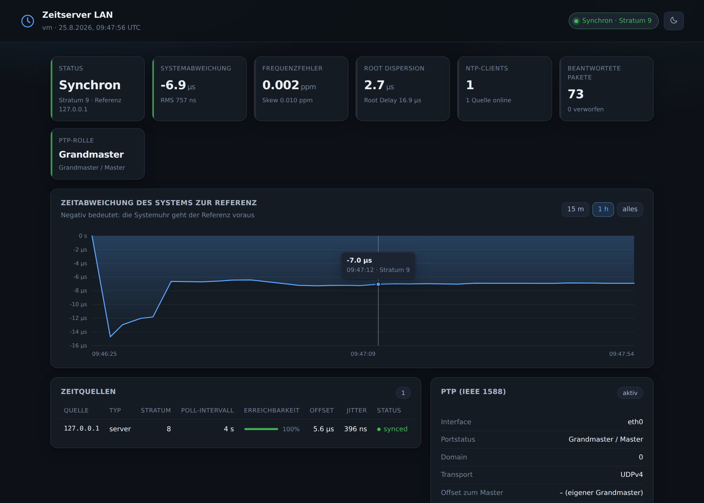
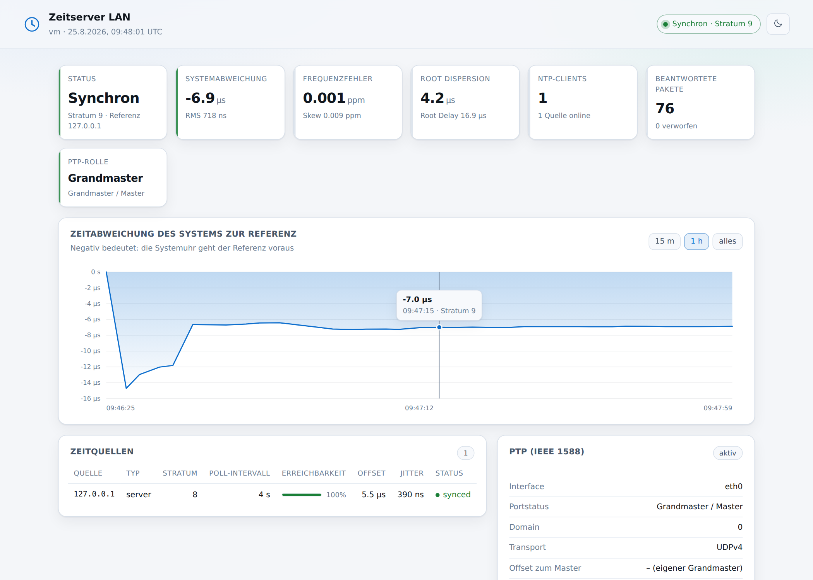

# ntp-gui

Ein Container, der **NTP (Chrony)** und **PTP (linuxptp)** ausliefert und beides in einem
Web-Dashboard sichtbar macht. Gedacht als kleine Zeitserver-Appliance für das eigene
Netz: in einer VM oder auf einem kleinen Host starten, die Adresse per **DHCP Option 42**
verteilen – fertig.



<details>
<summary>Helles Design</summary>


</details>

## Was drin ist

| Komponente | Zweck |
|---|---|
| `chronyd` | NTP-Server für das LAN (Port 123/udp) und NTP-Client zu den Upstream-Quellen |
| `ptp4l` / `phc2sys` | PTP (IEEE 1588) als Master oder Slave, optional zuschaltbar |
| Dashboard | Status, Offset-Verlauf, Zeitquellen, Clients, PTP-Zustand, aktive Konfiguration |
| `/metrics` | Prometheus-Endpunkt (Offset, Stratum, Quellen, Paketzähler, PTP) |
| `/healthz` | Health-Check für Docker/Kubernetes (ohne Login erreichbar) |

Das Dashboard kommt ohne Framework und ohne externe Abhängigkeiten aus – im Container
läuft nur `python3` aus der Distribution, dazu Chrony und linuxptp. Kein npm, kein pip.

## Schnellstart

```bash
docker compose up -d
# Dashboard: http://<host>:8080
```

Oder ohne Compose:

```bash
docker run -d --name ntp-gui \
  -p 123:123/udp -p 8080:8080 \
  --cap-add SYS_TIME \
  -e TZ=Europe/Berlin \
  -e NTP_POOLS=de.pool.ntp.org \
  -e ALLOW_NETWORKS=192.168.0.0/16 \
  ghcr.io/congp20/ntp-gui:latest
```

Prüfen, ob der Server antwortet:

```bash
chronyc -h <host> tracking      # oder
ntpdate -q <host>
```

### Warum `--cap-add SYS_TIME`?

Ohne diese Capability darf `chronyd` die Uhr nicht stellen. Der Container erkennt das
beim Start selbst und startet chronyd dann automatisch mit `-x`: er verteilt weiterhin
Zeit, diszipliniert aber die Uhr nicht mehr – die Genauigkeit hängt dann allein am Host.
Für einen echten Zeitserver also `SYS_TIME` setzen.

**Wichtig:** Container teilen sich die Uhr mit dem Host. Ein Container mit `SYS_TIME`
stellt damit die Uhr des *Hosts*. Deshalb gehört dieser Dienst in eine eigene VM oder auf
einen dedizierten Host – nicht auf einen Docker-Host, auf dem noch anderes läuft.

## Per DHCP verteilen (Option 42)

Der Zeitserver nützt nur etwas, wenn die Clients ihn kennen. DHCP Option 42 (`ntp-servers`)
verteilt die Adresse automatisch. Beispiele mit der Server-IP `192.168.1.10`:

**ISC dhcpd** (`/etc/dhcp/dhcpd.conf`)
```
option ntp-servers 192.168.1.10;
```

**Kea DHCPv4** (`kea-dhcp4.conf`)
```json
"option-data": [
  { "name": "ntp-servers", "data": "192.168.1.10" }
]
```

**dnsmasq**
```
dhcp-option=42,192.168.1.10
```

**OPNsense / pfSense**
Services → DHCP Server → (Interface) → *NTP Server 1* = `192.168.1.10`

**MikroTik RouterOS**
```
/ip dhcp-server network set [find] ntp-server=192.168.1.10
```

**UniFi**
Settings → Networks → (Netzwerk) → DHCP → *NTP Server* = `192.168.1.10`

**Windows Server DHCP**
Bereichsoptionen → *042 NTP-Server* → `192.168.1.10`

**FRITZ!Box**
Die FRITZ!Box verteilt Option 42 nicht frei konfigurierbar. Dort entweder Heimnetz →
Netzwerk → Netzwerkeinstellungen → *Zeitserver* setzen (sofern das Modell es anbietet),
oder die Clients direkt konfigurieren.

Für IPv6 ist Option 42 nicht zuständig – dort verteilt man NTP über DHCPv6 Option 56
(`OPTION_NTP_SERVER`) bzw. über den Router Advertisement Daemon.

## Konfiguration

Alles läuft über Umgebungsvariablen. Beim Start wird daraus eine `chrony.conf` erzeugt,
die im Dashboard unten einsehbar ist.

### NTP

| Variable | Default | Bedeutung |
|---|---|---|
| `NTP_POOLS` | `pool.ntp.org` | Pools, kommagetrennt |
| `NTP_SERVERS` | – | Einzelne Server, kommagetrennt |
| `NTP_PEERS` | – | Symmetrische Peers (z. B. ein zweiter Zeitserver im Cluster) |
| `NTP_SERVER_OPTIONS` | `iburst` | Optionen hinter jedem Server/Pool (z. B. `iburst minpoll 4`) |
| `NTP_POOL_MAXSOURCES` | `4` | Quellen je Pool |
| `ALLOW_NETWORKS` | alle privaten Netze | Wer die Zeit abfragen darf |
| `DENY_NETWORKS` | – | Ausnahmen dazu |
| `SERVE_UNSYNCED` | `true` | Zeit auch ohne Uplink ausliefern (Inselbetrieb) |
| `LOCAL_STRATUM` | `10` | Stratum im Inselbetrieb |
| `NTP_PORT` | `123` | NTP-Port |
| `BIND_ADDRESS` | – | Auf eine Adresse beschränken |
| `NTP_HW_TIMESTAMP` | `false` | Hardware-Zeitstempel für NTP (`hwtimestamp`) |
| `DISABLE_CLOCK_CONTROL` | `auto` | `true` = chronyd startet mit `-x`; `auto` erkennt fehlendes `CAP_SYS_TIME` |
| `MAKESTEP` | `1.0 3` | `makestep`-Parameter |
| `EXTRA_CHRONY_CONF` | – | Beliebige zusätzliche Zeilen (`\n` als Trenner) |

Reicht das nicht, mountet man eine eigene Datei nach `/config/chrony.conf` – die wird dann
unverändert übernommen und alle NTP-Variablen ignoriert.

### PTP

PTP braucht das **Host-Netzwerk** (Multicast) und für brauchbare Genauigkeit eine NIC mit
Hardware-Zeitstempeln. Vorher prüfen:

```bash
ethtool -T eth0   # "hardware-transmit"/"hardware-receive" und "PTP Hardware Clock: 0"
```

```bash
docker compose -f docker-compose.ptp.yml up -d
```

| Variable | Default | Bedeutung |
|---|---|---|
| `PTP_ENABLE` | `false` | ptp4l starten |
| `PTP_INTERFACE` | – | Interface, z. B. `eth0` (Pflicht, wenn aktiviert) |
| `PTP_MODE` | `auto` | `auto` (BMCA entscheidet), `master`, `slave` |
| `PTP_DOMAIN` | `0` | PTP-Domain |
| `PTP_TRANSPORT` | `UDPv4` | `UDPv4`, `UDPv6` oder `L2` |
| `PTP_TIME_STAMPING` | `hardware` | `hardware` oder `software` |
| `PTP_PRIORITY1` / `PTP_PRIORITY2` | `128` | BMCA-Priorität (kleiner = eher Grandmaster) |
| `PHC2SYS_ENABLE` | `false` | Systemuhr an die PTP-Hardwareuhr koppeln |
| `PHC2SYS_OPTIONS` | `-a -r -m` | Optionen für phc2sys |
| `EXTRA_PTP4L_CONF` | – | Zusätzliche Zeilen im `[global]`-Abschnitt |

Auch hier lässt sich alternativ eine eigene `/config/ptp4l.conf` mounten.

**PTP → NTP-Brücke:** Läuft der Container als PTP-Slave, kann Chrony die PTP-Hardwareuhr
direkt als Referenz benutzen und die Zeit als ganz normaler NTP-Server ins LAN geben:

```yaml
environment:
  PTP_ENABLE: "true"
  PTP_INTERFACE: "eth0"
  PTP_MODE: "slave"
  PHC_REFCLOCK: "/dev/ptp0"       # chrony: refclock PHC /dev/ptp0
  PHC2SYS_ENABLE: "true"
```

### Web

| Variable | Default | Bedeutung |
|---|---|---|
| `WEB_PORT` / `WEB_BIND` | `8080` / `0.0.0.0` | Adresse des Dashboards |
| `WEB_TITLE` | `NTP / PTP Time Server` | Überschrift |
| `WEB_USER` / `WEB_PASSWORD` | – | Beide gesetzt ⇒ HTTP Basic Auth |
| `WEB_REFRESH_SECONDS` | `5` | Aktualisierungsintervall im Browser |
| `HISTORY_INTERVAL` / `HISTORY_SIZE` | `10` / `720` | Messintervall und Länge des Verlaufs (Default: 2 h) |
| `WEB_ACCESS_LOG` | `false` | Zugriffe protokollieren |

Das Dashboard hat **keine Verschlüsselung**. Für Zugriff über unsichere Netze einen
Reverse Proxy mit TLS davorsetzen und `WEB_USER`/`WEB_PASSWORD` verwenden.

## Endpunkte

| Pfad | Inhalt |
|---|---|
| `/` | Dashboard |
| `/api/status` | Kompletter Zustand als JSON |
| `/api/history` | Offset-Verlauf (Ringpuffer im Speicher) |
| `/api/config` | Aktive `chrony.conf` |
| `/metrics` | Prometheus |
| `/healthz` | `200`, solange chronyd antwortet (ohne Login) |

## Entwicklung

```bash
python3 -m unittest discover -s tests -v     # Parser-Tests (ohne laufenden chronyd)
docker build -t ntp-gui .
```

Lokal ohne Container starten (setzt installiertes `chrony` voraus):

```bash
APP_DIR=$PWD/app CHRONY_CONF=/etc/chrony/chrony.conf WEB_PORT=8080 \
  DISABLE_CLOCK_CONTROL=true bash docker/entrypoint.sh
```

Die Tests decken die Ausgabeformate von `chronyc` und `pmc` ab – dort stecken die
Fallstricke: `reach` ist auch im CSV-Modus **oktal**, `activity` liefert eine einzige
CSV-Zeile, „nie gehört“ ist `4294967295` und `pmc` antwortet nur, wenn die **Domain**
übereinstimmt.

## Bekannte Einschränkungen

* Die Konfiguration ist read-only einsehbar; Änderungen laufen über Umgebungsvariablen
  bzw. eine gemountete Datei, nicht über das GUI.
* Der Offset-Verlauf liegt im Speicher und geht bei einem Neustart verloren. Für
  Langzeitdaten `/metrics` mit Prometheus abgreifen.
* `chronyc clients` zählt nur, solange das Client-Log Platz hat (`CLIENTLOGLIMIT`).
