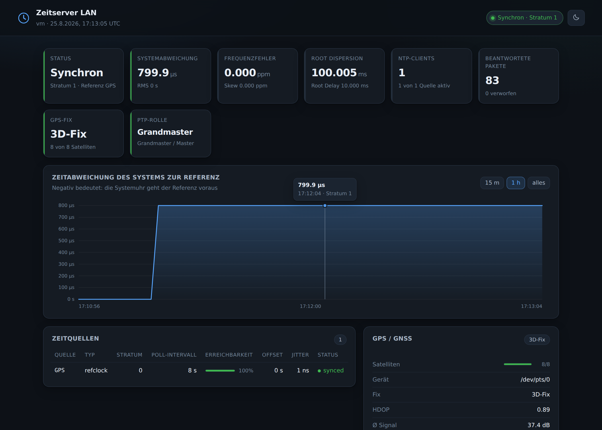

<p align="center">
<picture>
  <source media="(prefers-color-scheme: dark)" srcset="docs/graphics/banner-dark.svg">
  
</picture>
</p>

<p align="center">
  <a href="https://github.com/ConGp20/ntp-gui/actions/workflows/ci.yml"></a>
  <a href="https://github.com/ConGp20/ntp-gui/releases/latest"></a>
  
  
  <a href="LICENSE"></a>
</p>

<p align="center">
  <a href="#schnellstart">Schnellstart</a> ·
  <a href="#per-dhcp-verteilen-option-42">DHCP</a> ·
  <a href="#stratum-1-mit-gps">GPS</a> ·
  <a href="#ptp">PTP</a> ·
  <a href="#konfiguration">Konfiguration</a> ·
  <a href="#endpunkte">API</a>
</p>

Ein Container, der **NTP (chrony)**, optional einen **GPS-Empfänger** und **PTP (linuxptp)**
zusammenbringt und alles in einem Web-Dashboard sichtbar macht. Gedacht als kleine
Zeitserver-Appliance für das eigene Netz: in einer VM, auf einem Mini-PC oder einem
Raspberry Pi starten, die Adresse per **DHCP Option 42** verteilen – fertig.

| | |
|---|---|
| **Ein Container, alles drin** | chronyd, gpsd, ptp4l/phc2sys und das Dashboard, überwacht von einem Supervisor |
| **Stratum 1 ohne Internet** | mit einem USB-GPS wie dem VK-162 für ~15 €, auf Wunsch mit PPS |
| **Dashboard ohne Ballast** | reines Python aus der Distribution – kein npm, kein pip, ~100 KB Code |
| **Monitoring eingebaut** | JSON-API, Prometheus-`/metrics` und `/healthz` für den Healthcheck |
| **Konfiguriert per Umgebungsvariablen** | oder mit einer eigenen `chrony.conf`/`ptp4l.conf` unter `/config` |
| **Getestet** | 32 Unittests und ein 29-Punkte-Integrationstest gegen das gebaute Image in der CI |

## Auf einen Blick

<picture>
  <source media="(prefers-color-scheme: dark)" srcset="docs/dashboard-dark.png">
  
</picture>

## So funktioniert's

<picture>
  <source media="(prefers-color-scheme: dark)" srcset="docs/graphics/architecture-dark.svg">
  
</picture>

chronyd im Container sammelt die Zeit aus allen verfügbaren Quellen, wählt die beste und
stellt damit die Uhr. Ein GPS-Empfänger kommt über `gpsd` dazu, PTP über `ptp4l`. Die
Clients im LAN fragen per NTP auf Port 123 – welche Adresse sie fragen sollen, erfahren
sie beim Verbindungsaufbau per DHCP.

| Komponente | Zweck |
|---|---|
| `chronyd` | NTP-Server für das LAN (Port 123/udp) und NTP-Client zu den Upstream-Quellen |
| `gpsd` | Optional: USB-/serieller GPS-Empfänger als Stratum-0-Referenz, inkl. PPS |
| `ptp4l` / `phc2sys` | PTP (IEEE 1588) als Master oder Slave, optional zuschaltbar |
| Dashboard | Status, Offset-Verlauf, Zeitquellen, Clients, GPS-Fix, PTP-Zustand, aktive Konfiguration |
| `/metrics` | Prometheus-Endpunkt (Offset, Stratum, Quellen, Paketzähler, GPS, PTP) |
| `/healthz` | Health-Check für Docker/Kubernetes (ohne Login erreichbar) |

## Schnellstart

```bash
docker compose up -d
# Dashboard: http://<host>:8080
```

Oder ohne Compose:

```bash
docker run -d --name ntp-gui \
  -p 123:123/udp -p 8080:8080 \
  --cap-add SYS_TIME \
  -e TZ=Europe/Berlin \
  -e NTP_POOLS=de.pool.ntp.org \
  -e ALLOW_NETWORKS=192.168.0.0/16 \
  ghcr.io/congp20/ntp-gui:latest
```

Prüfen, ob der Server antwortet (von einem Client aus – `chronyc -h` funktioniert
hier nicht, weil der Kommando-Port des Containers bewusst deaktiviert ist):

```bash
ntpdate -q <host>                                      # oder
chronyd -Q -t 5 "server <host> iburst maxsamples 1"    # oder im Container:
docker exec ntp-gui chronyc tracking
```

### Warum `--cap-add SYS_TIME`?

Ohne diese Capability darf `chronyd` die Uhr nicht stellen. Der Container erkennt das
beim Start selbst und startet chronyd dann automatisch mit `-x`: er verteilt weiterhin
Zeit, diszipliniert aber die Uhr nicht mehr – die Genauigkeit hängt dann allein am Host.
Für einen echten Zeitserver also `SYS_TIME` setzen.

**Wichtig:** Container teilen sich die Uhr mit dem Host. Ein Container mit `SYS_TIME`
stellt damit die Uhr des *Hosts*. Deshalb gehört dieser Dienst in eine eigene VM oder auf
einen dedizierten Host – nicht auf einen Docker-Host, auf dem noch anderes läuft.

## Per DHCP verteilen (Option 42)

Der Zeitserver nützt nur etwas, wenn die Clients ihn kennen. DHCP Option 42 (`ntp-servers`)
verteilt die Adresse automatisch, der Client fragt danach direkt bei ntp-gui an:

<picture>
  <source media="(prefers-color-scheme: dark)" srcset="docs/graphics/dhcp-flow-dark.svg">
  
</picture>

Die Option wird im DHCP-Server eingetragen. Beispiele mit der Server-IP `192.168.1.10`:

**ISC dhcpd** (`/etc/dhcp/dhcpd.conf`)
```
option ntp-servers 192.168.1.10;
```

**Kea DHCPv4** (`kea-dhcp4.conf`)
```json
"option-data": [
  { "name": "ntp-servers", "data": "192.168.1.10" }
]
```

**dnsmasq**
```
dhcp-option=42,192.168.1.10
```

**OPNsense / pfSense**
Services → DHCP Server → (Interface) → *NTP Server 1* = `192.168.1.10`

**MikroTik RouterOS**
```
/ip dhcp-server network set [find] ntp-server=192.168.1.10
```

**UniFi**
Settings → Networks → (Netzwerk) → DHCP → *NTP Server* = `192.168.1.10`

**Windows Server DHCP**
Bereichsoptionen → *042 NTP-Server* → `192.168.1.10`

**FRITZ!Box**
Die FRITZ!Box verteilt Option 42 nicht frei konfigurierbar. Dort entweder Heimnetz →
Netzwerk → Netzwerkeinstellungen → *Zeitserver* setzen (sofern das Modell es anbietet),
oder die Clients direkt konfigurieren.

Für IPv6 ist Option 42 nicht zuständig – dort verteilt man NTP über DHCPv6 Option 56
(`OPTION_NTP_SERVER`) bzw. über den Router Advertisement Daemon.

## Stratum 1 mit GPS

Mit einem GPS-Empfänger wird der Container unabhängig vom Internet: `gpsd` liest den
Empfänger, chrony nutzt ihn als Referenzuhr und liefert die Zeit als Stratum 1 ins LAN.



Ein **VK-162** (u-blox 7, ~15 €) ist dafür der einfachste Einstieg: einstecken, er meldet
sich als `/dev/ttyACM0`, kein Treiber nötig. Antenne ans Fenster oder nach draußen –
ohne Himmelssicht gibt es keinen Fix.

```bash
dmesg | grep -i -E "ttyACM|ttyUSB|u-blox"   # welches Gerät ist es?
docker compose -f docker-compose.gps.yml up -d
```

Oder direkt:

```bash
docker run -d --name ntp-gui \
  -p 123:123/udp -p 8080:8080 \
  --cap-add SYS_TIME \
  --device /dev/ttyACM0 \
  -e GPS_ENABLE=true -e GPS_DEVICE=/dev/ttyACM0 \
  -e ALLOW_NETWORKS=192.168.0.0/16 \
  ghcr.io/congp20/ntp-gui:latest
```

Das Gerät **muss** per `--device` bzw. `devices:` durchgereicht werden – ein Container
sieht `/dev/ttyACM0` sonst nicht.

### Wie genau wird das?

<picture>
  <source media="(prefers-color-scheme: dark)" srcset="docs/graphics/accuracy-dark.svg">
  
</picture>

Die Bremse beim USB-Empfänger ist nicht das GPS, sondern der USB-Bus: die NMEA-Sätze
kommen gepuffert und mit schwankender Verzögerung an. Für ein Heimnetz, in dem sonst
alles über das Internet synchronisiert, ist das trotzdem eine deutliche Verbesserung –
und der Dienst läuft dann auch ohne Internetanbindung weiter.

Wer die Nanosekunden-Klasse will, braucht einen Empfänger mit PPS-Ausgang. Jeff Geerlings
[time-pi](https://github.com/geerlingguy/time-pi) ist genau das: Raspberry Pi 5 mit
PPS-fähigem GPS-Modul, das als PTP-Grandmaster arbeitet – dieselbe Kombination, die
dieser Container mit `GPS_PPS_DEVICE` und `PTP_ENABLE` abbildet.

### Offset kalibrieren

Ein USB-Empfänger liefert die Zeit systematisch zu spät. Diesen konstanten Versatz nimmt
`GPS_OFFSET` heraus. Vorgehen: erst einige Stunden mit guten Internet-Quellen mitlaufen
lassen, dann den mittleren Offset des GPS-Refclocks ablesen –

```bash
docker exec ntp-gui-gps chronyc sourcestats
docker exec ntp-gui-gps chronyc sources   # Spalte "Last sample" der Zeile "#? GPS"
```

– und den abgelesenen Wert als `GPS_OFFSET` in Sekunden eintragen (positiver Wert
verschiebt die GPS-Zeit nach vorne). Danach steht der Refclock auf `#*`.

### PPS zusätzlich nutzen

Empfänger mit PPS-Ausgang (GPS-HAT, Modul an einem GPIO, USB-Adapter mit DCD-Leitung)
liefern eine Sekundenflanke, die um Größenordnungen genauer ist als die NMEA-Sätze.
Am Raspberry Pi wird der PPS-Pin über einen Overlay in `/boot/firmware/config.txt`
sichtbar gemacht:

```
dtoverlay=pps-gpio,gpiopin=18
```

Danach `/dev/pps0` in den Container reichen und aktivieren:

```yaml
devices:
  - /dev/ttyAMA0:/dev/ttyAMA0
  - /dev/pps0:/dev/pps0
environment:
  GPS_ENABLE: "true"
  GPS_DEVICE: "/dev/ttyAMA0"
  GPS_PPS_DEVICE: "/dev/pps0"
```

chrony bekommt dann zwei Refclocks: `GPS` liefert die grobe Zeit (welche Sekunde),
`PPS` die exakte Flanke (`lock GPS`). Der VK-162 hat **kein** PPS.

### Wenn der Refclock nicht anspringt

`chronyc sources` zeigt den GPS-Refclock als `#? GPS` (keine Samples) statt `#* GPS`:

| Symptom | Ursache |
|---|---|
| Dashboard: „gpsd antwortet nicht" | Gerät nicht durchgereicht (`--device`) oder falscher Pfad |
| GPS-Fix bleibt „kein Fix" | Antenne ohne Himmelssicht; ein Kaltstart dauert bis zu 15 Minuten |
| Fix vorhanden, Refclock trotzdem `#?` | gpsd schreibt in ein anderes SHM-Segment → `GPS_SHM_UNIT=2` probieren |
| PPS-Zeile fehlt in der chrony.conf | `GPS_PPS_DEVICE` zeigt auf ein Gerät, das im Container nicht existiert – der Container überspringt sie bewusst, weil chronyd sonst gar nicht startet |
| Offset konstant ein paar hundert ms | normal bei USB – siehe Kalibrierung oben |

Ein Detail für Tests: **gpsd akzeptiert keine PTY- oder TCP-Quellen als Zeitreferenz**
(`ntpshm_alloc: sourcetype ... not using for NTP`). Ein per `socat` simulierter Empfänger
liefert also Position und Satelliten, aber niemals Samples für chrony – dafür braucht es
ein echtes serielles bzw. USB-Gerät.

## Konfiguration

Alles läuft über Umgebungsvariablen. Beim Start wird daraus eine `chrony.conf` erzeugt,
die im Dashboard unten einsehbar ist.

### NTP

| Variable | Default | Bedeutung |
|---|---|---|
| `NTP_POOLS` | `pool.ntp.org` | Pools, kommagetrennt |
| `NTP_SERVERS` | – | Einzelne Server, kommagetrennt |
| `NTP_PEERS` | – | Symmetrische Peers (z. B. ein zweiter Zeitserver im Cluster) |
| `NTP_SERVER_OPTIONS` | `iburst` | Optionen hinter jedem Server/Pool (z. B. `iburst minpoll 4`) |
| `NTP_POOL_MAXSOURCES` | `4` | Quellen je Pool |
| `ALLOW_NETWORKS` | alle privaten Netze | Wer die Zeit abfragen darf |
| `DENY_NETWORKS` | – | Ausnahmen dazu |
| `SERVE_UNSYNCED` | `true` | Zeit auch ohne Uplink ausliefern (Inselbetrieb) |
| `LOCAL_STRATUM` | `10` | Stratum im Inselbetrieb |
| `NTP_PORT` | `123` | NTP-Port |
| `BIND_ADDRESS` | – | Auf eine Adresse beschränken |
| `NTP_HW_TIMESTAMP` | `false` | Hardware-Zeitstempel für NTP (`hwtimestamp`) |
| `DISABLE_CLOCK_CONTROL` | `auto` | `true` erzwingt `-x` (Uhr wird nie gestellt). Bei `auto` und bei `false` prüft der Container `CAP_SYS_TIME` und ergänzt `-x` nur, wenn die Capability fehlt |
| `MAKESTEP` | `1.0 3` | `makestep`-Parameter |
| `EXTRA_CHRONY_CONF` | – | Beliebige zusätzliche Zeilen (`\n` als Trenner) |

Reicht das nicht, mountet man eine eigene Datei nach `/config/chrony.conf` – die wird dann
unverändert übernommen und alle NTP-Variablen ignoriert.

### GPS

| Variable | Default | Bedeutung |
|---|---|---|
| `GPS_ENABLE` | `false` | gpsd starten und Refclock in die chrony.conf schreiben |
| `GPS_DEVICE` | `/dev/ttyACM0` | Gerätepfad des Empfängers |
| `GPS_SPEED` | – | Feste Baudrate (nur bei seriellen Empfängern nötig) |
| `GPS_OFFSET` | `0.0` | Konstanter Zeitversatz in Sekunden (Kalibrierung) |
| `GPS_REFID` | `GPS` | Name des Refclocks in `chronyc sources` |
| `GPS_SHM_UNIT` | `0` | SHM-Segment, über das gpsd die Zeit übergibt |
| `GPS_POLL` / `GPS_FILTER` | `3` / `3` | Poll-Intervall (2^n s) und Medianfilter |
| `GPS_DELAY` / `GPS_PRECISION` | `0.2` / `1e-1` | Angenommene Verzögerung und Auflösung |
| `GPS_PPS_DEVICE` | – | PPS-Gerät, z. B. `/dev/pps0` |
| `GPS_PPS_SHM` | `false` | PPS stattdessen über gpsd (SHM-Unit 1) |
| `GPS_WAIT_SECONDS` | `10` | So lange auf das Gerät warten (USB taucht nach dem Boot verzögert auf) |
| `GPS_SHOW_POSITION` | `false` | Koordinaten im Dashboard anzeigen |
| `GPS_REFCLOCK_OPTIONS` | – | Zusätzliche chrony-Refclock-Optionen |

### PTP

PTP braucht das **Host-Netzwerk** (Multicast) und für brauchbare Genauigkeit eine NIC mit
Hardware-Zeitstempeln. Vorher prüfen:

```bash
ethtool -T eth0   # "hardware-transmit"/"hardware-receive" und "PTP Hardware Clock: 0"
```

```bash
docker compose -f docker-compose.ptp.yml up -d
```

| Variable | Default | Bedeutung |
|---|---|---|
| `PTP_ENABLE` | `false` | ptp4l starten |
| `PTP_INTERFACE` | – | Interface, z. B. `eth0` (Pflicht, wenn aktiviert) |
| `PTP_MODE` | `auto` | `auto` (BMCA entscheidet), `master`, `slave` |
| `PTP_DOMAIN` | `0` | PTP-Domain |
| `PTP_TRANSPORT` | `UDPv4` | `UDPv4`, `UDPv6` oder `L2` |
| `PTP_TIME_STAMPING` | `hardware` | `hardware` oder `software` |
| `PTP_PRIORITY1` / `PTP_PRIORITY2` | `128` | BMCA-Priorität (kleiner = eher Grandmaster) |
| `PHC2SYS_ENABLE` | `false` | Systemuhr an die PTP-Hardwareuhr koppeln |
| `PHC2SYS_OPTIONS` | `-a -r -m` | Optionen für phc2sys |
| `EXTRA_PTP4L_CONF` | – | Zusätzliche Zeilen im `[global]`-Abschnitt |

Auch hier lässt sich alternativ eine eigene `/config/ptp4l.conf` mounten.

**PTP → NTP-Brücke:** Läuft der Container als PTP-Slave, kann Chrony die PTP-Hardwareuhr
direkt als Referenz benutzen und die Zeit als ganz normaler NTP-Server ins LAN geben:

```yaml
environment:
  PTP_ENABLE: "true"
  PTP_INTERFACE: "eth0"
  PTP_MODE: "slave"
  PHC_REFCLOCK: "/dev/ptp0"       # chrony: refclock PHC /dev/ptp0
  PHC2SYS_ENABLE: "true"
```

In dieser Kombination stellt **phc2sys** die Systemuhr, und chronyd läuft automatisch
mit `-x` – zwei Regler auf derselben Uhr würden sich sonst gegenseitig die
Frequenzkorrekturen überschreiben. chronyd bleibt dabei voller NTP-Server; der
PHC-Refclock dient ihm als Referenz für Stratum und Statistik.

### Web

| Variable | Default | Bedeutung |
|---|---|---|
| `WEB_PORT` / `WEB_BIND` | `8080` / `0.0.0.0` | Adresse des Dashboards |
| `WEB_TITLE` | `NTP / PTP Time Server` | Überschrift |
| `WEB_USER` / `WEB_PASSWORD` | – | Beide gesetzt ⇒ HTTP Basic Auth |
| `WEB_REFRESH_SECONDS` | `5` | Aktualisierungsintervall im Browser |
| `HISTORY_INTERVAL` / `HISTORY_SIZE` | `10` / `720` | Messintervall und Länge des Verlaufs (Default: 2 h) |
| `WEB_ACCESS_LOG` | `false` | Zugriffe protokollieren |

Das Dashboard hat **keine Verschlüsselung**. Für Zugriff über unsichere Netze einen
Reverse Proxy mit TLS davorsetzen und `WEB_USER`/`WEB_PASSWORD` verwenden.

### Was im Container unter welchem Benutzer läuft

| Prozess | Benutzer | Warum |
|---|---|---|
| `chronyd` | `_chrony` | legt Privilegien nach dem Start selbst ab |
| `gpsd` | `gpsd` | ebenso |
| `ptp4l` / `phc2sys` | root | brauchen `CAP_NET_ADMIN` für Hardware-Zeitstempel |
| Dashboard (`python3`) | root | ruft `chronyc` und `pmc` auf, deren Sockets root bzw. `_chrony` gehören |

Das Dashboard schreibt nichts, führt keine Shell-Kommandos aus (alle Aufrufe nutzen feste
Argumentlisten) und hat keinen Upload-Pfad. Trotzdem gilt: der Container ist für das eigene
LAN gedacht, nicht für das offene Internet. Wer ihn exponiert, gehört hinter einen Reverse
Proxy mit TLS und Authentifizierung.

`/healthz` ist **bewusst ohne Login** erreichbar, damit der Docker-Healthcheck funktioniert.
Der Endpunkt verrät nur, ob chronyd antwortet.

## Endpunkte

| Pfad | Inhalt |
|---|---|
| `/` | Dashboard |
| `/api/status` | Kompletter Zustand als JSON |
| `/api/history` | Offset-Verlauf (Ringpuffer im Speicher) |
| `/api/config` | Aktive `chrony.conf` |
| `/metrics` | Prometheus |
| `/healthz` | `200`, solange chronyd antwortet (ohne Login) |

## Entwicklung

```bash
python3 -m unittest discover -s tests -v     # Parser-Tests (ohne laufenden chronyd)
docker build -t ntp-gui:test .
tests/container-test.sh ntp-gui:test         # Integrationstest gegen das gebaute Image
```

Der Integrationstest startet echte Container und prüft das, was Unittests nicht abdecken:
Erkennung von fehlendem `CAP_SYS_TIME`, Healthcheck, alle Endpunkte, Basic-Auth,
gemountete Konfiguration, Verhalten ohne GPS-/PTP-Hardware, eine echte NTP-Abfrage über
das Netz und die Exit-Codes beim Stoppen. Dieselbe Datei läuft in der CI gegen das
gebaute Image.

Lokal ohne Container starten (setzt installiertes `chrony` voraus; als root, und der
System-chronyd sollte gestoppt sein). `CHRONY_CONF` auf einen Scratch-Pfad zeigen
lassen – der Entrypoint überschreibt die Datei, die dort liegt:

```bash
APP_DIR=$PWD/app CHRONY_CONF=/tmp/ntp-gui-chrony.conf NTP_PORT=10123 WEB_PORT=8080 \
  DISABLE_CLOCK_CONTROL=true bash docker/entrypoint.sh
```

Die Tests decken die Ausgabeformate von `chronyc`, `pmc` und `gpsd` ab – dort stecken die
Fallstricke: `reach` ist auch im CSV-Modus **oktal**, `activity` liefert eine einzige
CSV-Zeile, „nie gehört“ ist `4294967295` und `pmc` antwortet nur, wenn die **Domain**
übereinstimmt, und gpsd liefert die Satellitenliste nur in manchen Zyklen mit.

## Bekannte Einschränkungen

* Die Konfiguration ist read-only einsehbar; Änderungen laufen über Umgebungsvariablen
  bzw. eine gemountete Datei, nicht über das GUI.
* Der Offset-Verlauf liegt im Speicher und geht bei einem Neustart verloren. Für
  Langzeitdaten `/metrics` mit Prometheus abgreifen.
* `chronyc clients` zählt nur, solange das Client-Log Platz hat (`CLIENTLOGLIMIT`).
* Das Dashboard bringt kein TLS mit – für Zugriffe außerhalb des vertrauenswürdigen Netzes
  gehört ein Reverse Proxy davor.
* PTP braucht das Host-Netzwerk; über eine Docker-Bridge funktioniert es nicht.

## Release

Veröffentlicht wird über GitHub Actions: im Repo unter **Actions → Release → Run workflow**
die Version eintragen (z. B. `1.0.0`) und starten. Der Workflow

1. lehnt Versionen ab, die kein SemVer sind oder deren Tag schon existiert,
2. führt Unittests und den Integrationstest gegen das frisch gebaute Image aus,
3. baut das Image für `linux/amd64` und `linux/arm64` und pusht es nach
   `ghcr.io/<owner>/ntp-gui` mit den Tags `1.0.0`, `1.0` und `latest`,
4. legt erst danach den Git-Tag `v1.0.0` und das GitHub-Release an.

Scheitert ein Schritt, entsteht kein halber Release. Bei einem privaten Repository
ist auch das Image zunächst privat (`docker login ghcr.io` nötig); die Sichtbarkeit
lässt sich in den Package-Einstellungen auf GitHub ändern.

## Lizenz

[MIT](LICENSE)
